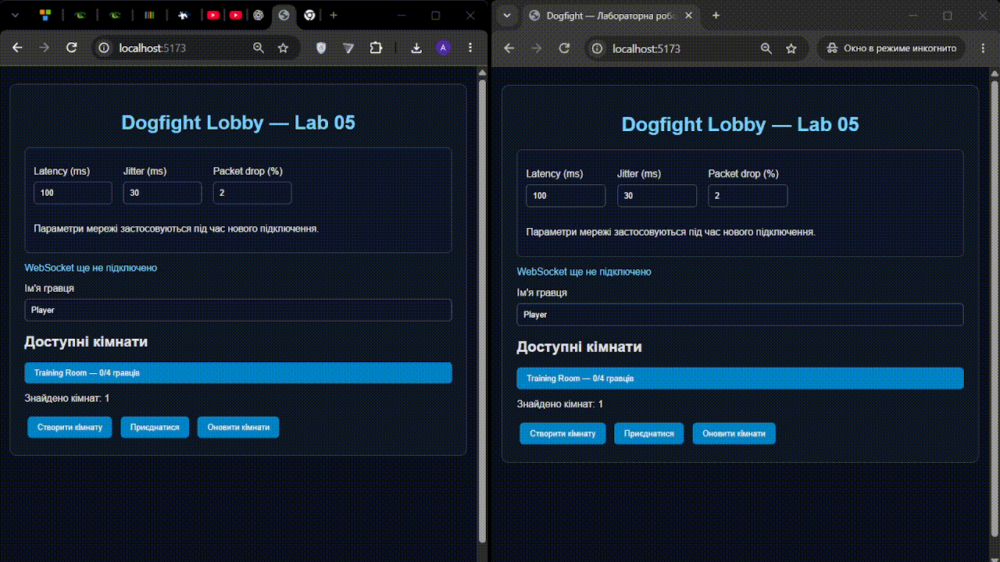

# Dogfight — лабораторна робота № 5

## Мережева гра в реальному часі

### 1. Мета роботи

Реалізація багатокористувацької гри з авторитетним сервером, детермінованою симуляцією, передбаченням руху клієнта, інтерполяцією та бінарним протоколом передавання даних.

### 2. Реалізовані можливості

- Серверна симуляція з частотою 30 Hz.
- Спільна детермінована симуляція з використанням `mulberry32`.
- Передавання команд керування з послідовними номерами `seq`.
- Передбачення руху власного корабля та reconciliation.
- Інтерполяція віддалених гравців та ігрових об'єктів.
- Синхронізація кораблів, астероїдів, куль і бонусів.
- Серверна обробка зіткнень, пошкоджень та рахунку.
- Емуляція затримки, jitter і втрати пакетів.
- Бінарний протокол на основі `DataView`.

### 3. Демонстрація двох гравців




### 4. Порівняння JSON і Binary

Для порівняння використовується команда:

```powershell
npm run bench:codec
```

Попередні результати benchmark:

| Показник | JSON | Binary |
|---|---:|---:|
| Розмір snapshot | 1824 байти | 642 байти |
| Вхідний трафік | 53,438 KB/s | 18,809 KB/s |
| Вихідний трафік | 1,758 KB/s | 0,381 KB/s |
| Кодування + декодування | 8,326 мкс | 1,990 мкс |

**Висновок:** Binary має менший розмір повідомлень і менші витрати на обробку порівняно з JSON.

### 5. Аналіз мережевої взаємодії

Тестові параметри:

| Параметр | Значення |
|---|---:|
| Затримка | 100 мс |
| Jitter | ±30 мс |
| Втрата пакетів | 2% |
| Серверна частота | 30 Hz |
| Інтерполяція | 100 мс |

**Затримка.** Клієнт використовує передбачення руху, тому керування власним кораблем не очікує відповіді сервера. Після отримання snapshot виконується корекція локального стану.

Фактичний RTT: **У середньому 80-120 мс**.

**Розбіжність стану.** Показник `correctionMagnitude` відображає різницю між передбаченим і скоригованим станом корабля.

- Типове значення: **4**.
- Максимальне значення: **5**.

**Захист від читерства.** Клієнт передає лише команди керування, а не координати корабля чи результати зіткнень. Сервер самостійно перевіряє команди, обробляє рух, стрільбу, влучання та нарахування очок. Це унеможливлює просту підміну клієнтом координат і рахунку.

**Затримка інтерполяції.** Обрано 100 мс. Це компроміс між плавністю відображення віддалених об'єктів та актуальністю їхнього положення. Буфер допомагає компенсувати нерівномірне надходження snapshots за заданих умов тестування.

### 6. Запуск проєкту

Встановлення залежностей:

```powershell
npm install
```

Запуск тестів:

```powershell
npm test
```

Benchmark:

```powershell
npm run bench:codec
```

Запуск сервера в першому терміналі:

```powershell
npm run dev:server
```

Запуск клієнта в другому терміналі:

```powershell
npm run dev:client
```

Відкрити `http://localhost:5173/` у двох вікнах браузера та підключити гравців до однієї кімнати.

### 7. Висновок

У результаті роботи реалізовано багатокористувацьку гру з авторитетним сервером, передбаченням руху, узгодженням стану та інтерполяцією. Реалізовано синхронізацію ігрових об'єктів і бінарний протокол, який зменшує обсяг переданих даних порівняно з JSON. Мережева взаємодія перевіряється за допомогою емуляції затримки, jitter та втрати пакетів.