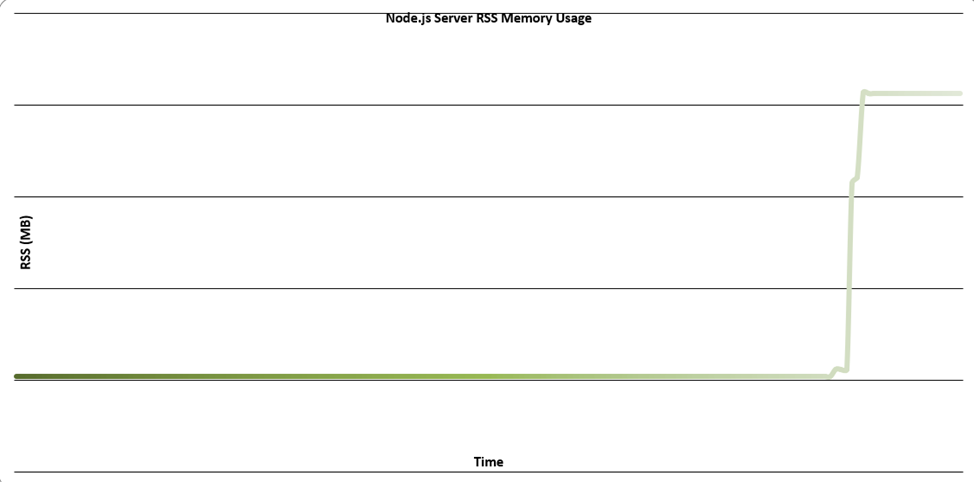

# Dogfight — лабораторна робота №4

## 1. Мета роботи

Розширити клієнтську гру Dogfight серверною частиною на Node.js та дослідити асинхронну модель виконання, WebSocket-взаємодію, потокову обробку даних і використання пам’яті.

## 2. Короткий опис виконаної роботи

У межах роботи реалізовано:

- HTTP-сервер на Node.js та API для перевірки стану сервера й керування ігровими кімнатами;
- WebSocket-з’єднання для обміну повідомленнями між гравцями, приєднання/виходу з кімнат та оновлення списку учасників;
- перевірку формату й версії повідомлень, обробку помилок, обмеження частоти повідомлень і контроль активності з’єднань;
- потокове логування подій матчів у форматі NDJSON та читання replay-файлів;
- потокове передавання великих обсягів даних із використанням Streams і механізму backpressure;
- тестові HTTP-маршрути для демонстрації блокування event loop і потокового передавання великих даних;
- підключення клієнтської частини гри до серверного API та WebSocket.

## 3. Запуск проєкту

Потрібен Node.js версії 22 або новішої. У корені проєкту встановити залежності:

```powershell
npm install
```

У першому терміналі запустити сервер:

```powershell
npm run dev:server
```

У другому терміналі запустити клієнт:

```powershell
npm run dev:client
```

Відкрити адресу Vite, зазвичай `http://localhost:5173/`. Сервер доступний на `http://127.0.0.1:3001`.

## 4. Основні HTTP-маршрути

| Метод і маршрут | Призначення |
|---|---|
| `GET /health` | Перевірка стану сервера |
| `GET /api/rooms` | Отримання списку кімнат |
| `POST /api/rooms` | Створення кімнати |
| `GET /api/replays` | Отримання списку записів матчів |
| `GET /api/replays/:filename` | Потокове читання replay-файлу |
| `GET /api/slow?ms=500` | Демонстрація синхронного блокування event loop |
| `GET /api/large-stream?mb=200` | Генерація та потокове передавання великого NDJSON-потоку (1–200 МБ) |

## 5. WebSocket та кімнати

Клієнт підключається до маршруту `/ws`. Повідомлення використовують версію протоколу `v: 1`. Підтримуються операції приєднання до кімнати, надсилання повідомлень чату та виходу. Сервер повідомляє клієнтів про приєднання й вихід учасників, оновлює список гравців та відхиляє некоректні повідомлення. Для повільних клієнтів контролюється розмір буфера відправлення, щоб не накопичувати необмежену кількість даних.

## 6. Потокове логування, replay та backpressure

Події ігрових кімнат записуються у NDJSON-файли через потоки. Replay читається поступово, а не завантажується повністю в оперативну пам’ять. Маршрут `/api/large-stream?mb=200` дає змогу перевірити передавання великого обсягу даних. Backpressure узгоджує швидкість генерації даних зі швидкістю їх отримання клієнтом. Тому за повільного каналу серверу не потрібно зберігати весь файл у пам’яті: передавання відбувається частинами, а потік призупиняється/відновлюється відповідно до готовності приймача.

## 7. Моніторинг пам’яті (RSS) під час повільного завантаження

Для перевірки було запущено сервер і вимірювано його Working Set (практичний аналог RSS у Windows) з інтервалом приблизно 0,5 секунди. Паралельно клієнт завантажував великий потік через повільний канал. Нижче наведено графік за фактичними вимірюваннями.



**Результати вимірювання:**

| Показник | Значення |
|---|---:|
| Кількість вимірювань | 175 |
| Початковий RSS | 56,08 МБ |
| Максимальний зафіксований RSS | 62,27 МБ |
| Приріст від початкового значення | 6,19 МБ |
| Рівень після зростання | близько 62,25 МБ |

На початку вимірювання RSS залишався близько 56,08 МБ. Під час передавання спостерігалося коротке зростання, після чого використання пам’яті стабілізувалося приблизно на рівні 62,25 МБ. Крива не зростала пропорційно до розміру переданих 200 МБ. Це узгоджується з потоковою обробкою: дані передаються невеликими частинами, а backpressure не дозволяє необмежено накопичувати їх у пам’яті.

*Примітка: у Windows для цього вимірювання використовувався `WorkingSet64` процесу сервера як практичний показник RSS.*

## 8. Блокування event loop та подія `error`

**Що станеться, якщо HTTP-обробник займе event loop на 300 мс?** Оскільки JavaScript-код обробника виконується синхронно в основному потоці Node.js, протягом цих 300 мс цикл подій не зможе обробляти інші callback-функції. Через це затримаються відповіді на інші HTTP-запити, WebSocket-повідомлення й таймери. Такий обробник погіршує чутливість усього сервера, навіть якщо сам запит короткий.

**Чому `error` без слухача завершує процес?** У Node.js подія `error` в `EventEmitter` має спеціальну поведінку: якщо емітер генерує `error`, але для неї не зареєстровано обробник `on('error', ...)`, помилка вважається неперехопленою і Node.js викидає виняток. Якщо його не перехопити, процес завершується. Тому для потоків та інших EventEmitter-об’єктів потрібно передбачати обробник `error`.

## 9. Висновок

У роботі створено серверну частину гри Dogfight на Node.js, реалізовано HTTP API, WebSocket-взаємодію, керування кімнатами, потокове логування та читання replay-файлів. Перевірка великого потоку показала, що під час передавання 200 МБ через повільний канал RSS збільшився з 56,08 до 62,27 МБ і надалі залишався майже стабільним. Це демонструє користь Streams і backpressure для роботи з великими файлами. Також розглянуто наслідки блокування event loop та необхідність обробляти подію `error`, щоб уникнути аварійного завершення процесу.

## 10. Контрольні питання

**Що таке Node.js?** — Середовище виконання JavaScript поза браузером на основі рушія V8.

**Що таке event loop?** — Механізм, який координує виконання синхронного коду та асинхронних callback-функцій.

**Для чого потрібен libuv?** — Для реалізації циклу подій, пулу потоків і асинхронної взаємодії з операційною системою.

**Чим відрізняються CommonJS та ES Modules?** — CommonJS використовує `require` і `module.exports`, а ES Modules — `import` та `export`.

**Що таке WebSocket?** — Протокол постійного двостороннього зв’язку між клієнтом і сервером.

**Що таке backpressure?** — Механізм, який узгоджує швидкість виробника даних зі швидкістю їх споживача.

**Для чого потрібні Streams?** — Для обробки й передавання даних частинами без завантаження всього обсягу в пам’ять.

**Навіщо потрібен heartbeat?** — Для виявлення неактивних або розірваних WebSocket-з’єднань.

**Навіщо перевіряти WebSocket-повідомлення?** — Щоб відхиляти некоректні дані, невідомі типи та повідомлення з неправильною версією протоколу.
