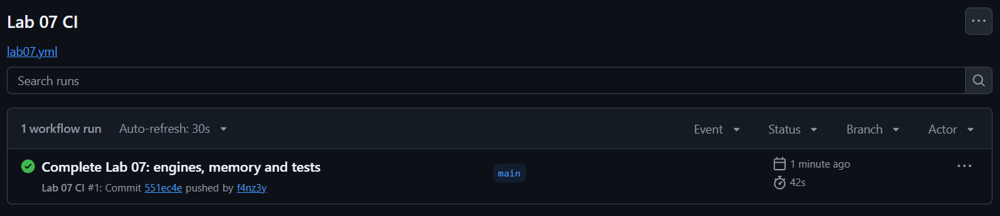
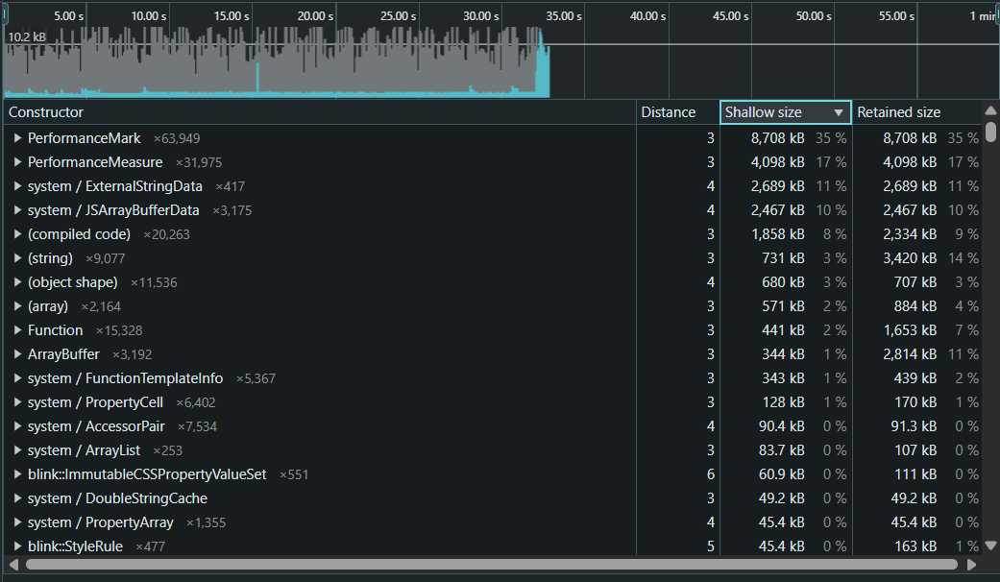
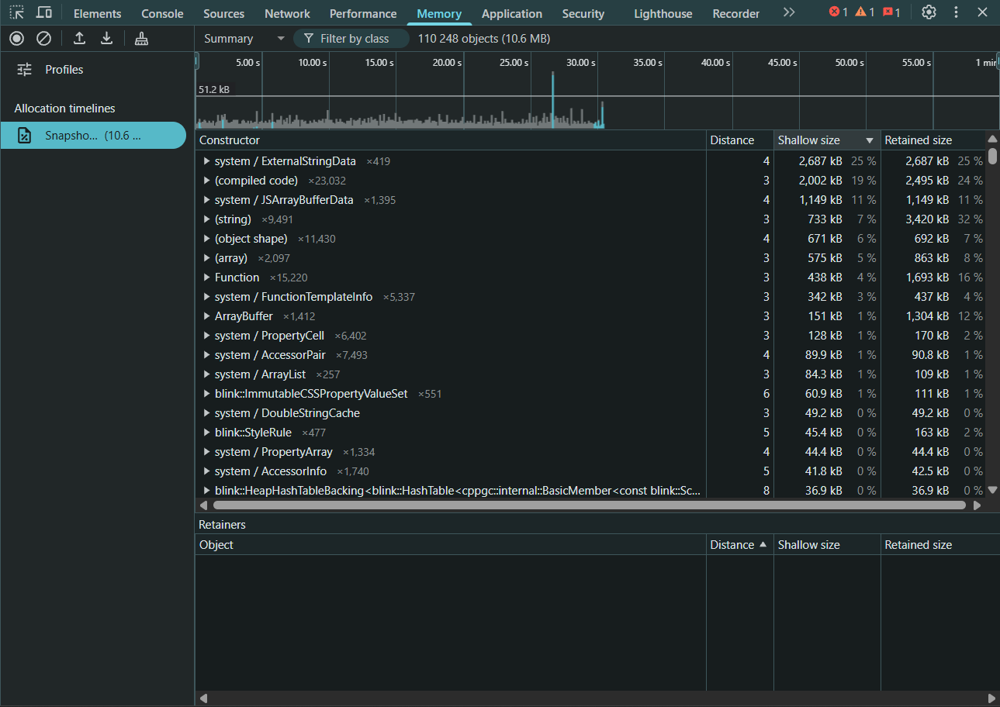
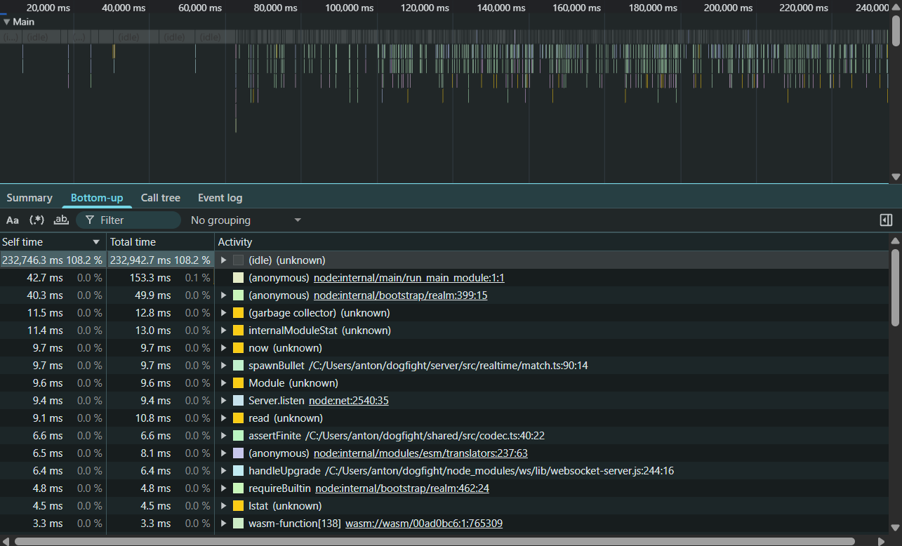

# Лабораторна робота №7 --- Engines, Memory and Tests

**Проєкт:** Dogfight --- багатокористувацька браузерна гра\
**Технології:** TypeScript, Node.js, WebSocket, Vite, Vitest,
Playwright, GitHub Actions

## 1. Мета роботи

Дослідити продуктивність клієнтської та серверної частин гри,
використати інструменти профілювання CPU і пам'яті, оптимізувати ігровий
цикл, налаштувати автоматизоване тестування та CI, а також оцінити
масштабованість сервера за різної кількості підключених клієнтів.

## 2. Автоматизоване тестування

Для перевірки коректності роботи застосунку використано Vitest,
Playwright, ESLint і TypeScript.

  Перевірка             Результат
  --------------------- -----------------------
  Vitest                88/88 тестів пройдено
  Офлайн-тести          86/86 тестів пройдено
  Покриття операторів   97,87%
  Покриття гілок        97,22%
  Покриття функцій      100%
  Покриття рядків       97,87%
  Playwright E2E        1/1 тест пройдено
  ESLint                Без помилок
  TypeScript            Без помилок
  Production build      Успішно

E2E-тест перевіряє підключення двох незалежних браузерних клієнтів,
відображення списку гравців та обмін повідомленнями чату.

## 3. Безперервна інтеграція

Налаштовано GitHub Actions workflow `.github/workflows/lab07.yml` для
автоматичної перевірки проєкту.

Підтверджено успішне виконання CI для коміту `551ec4e` у гілці `main`.

## 4. Профілювання та оптимізація клієнта

Профілювання проводилося в Chrome DevTools під час роботи гри з вісьмома
ботами.

### 4.1. Стан до оптимізації

У вкладці Performance виявлено такі операції з найбільшим власним часом
виконання:

  Операція                      Self time
  --------------------------- -----------
  `mark`                        1066,8 мс
  `Layout`                      1062,6 мс
  `Paint`                        645,5 мс
  `Function call (main.ts)`      618,9 мс
  `set textContent`              581,8 мс

Аналіз виділення пам'яті показав значну кількість об'єктів, створених
інструментуванням ігрового циклу:

-   `PerformanceMark` --- 63 949 об'єктів, 8708 КБ.
-   `PerformanceMeasure` --- 31 975 об'єктів, 4098 КБ.
-   `ExternalStringData` --- 2689 КБ.

### 4.2. Виконана оптимізація

Із циклу `frame()` прибрано багаторазові виклики `performance.mark()` і
`performance.measure()`. Для вимірювання тривалості обробки кадру
залишено легший механізм на основі `performance.now()` та кільцевого
буфера статистики.

Діагностичну функцію `getFrameMetrics` винесено за межі циклу кадрів,
щоб уникнути її повторного створення.

### 4.3. Результати після оптимізації

  Метрика                       До     Після   Покращення
  ---------------------- --------- --------- ------------
  Frame processing p50     0,30 мс   0,20 мс        33,3%
  Frame processing p95     0,50 мс   0,40 мс        20,0%
  Frame processing p99     0,60 мс   0,40 мс        33,3%

Ці значення характеризують час виконання вимірюваної частини
JavaScript-циклу `frame()`, а не повний час формування браузерного
кадру.

Після оптимізації об'єкти `PerformanceMark` і `PerformanceMeasure`
більше не домінували серед основних категорій виділення пам'яті. У
новому профілі найбільші категорії становили `ExternalStringData` (2687
КБ), скомпільований код (2002 КБ) та `JSArrayBufferData` (1149 КБ).

Під час окремого профілювання після оптимізації також зафіксовано 11
подій Major GC сумарною тривалістю приблизно 28,8 мс. Отже, ціль
нульової кількості Major GC у вимірюваному інтервалі не досягнуто.

## 5. Профілювання сервера

Для дослідження серверної частини використано CPU Profiler Node.js та
Chrome DevTools.

Профіль показав, що значну частину часу процес перебував у стані
очікування. Серед операцій застосунку зафіксовано `spawnBullet` та
`assertFinite`, однак за цим профілем не встановлено критичного
CPU-вузького місця.

## 6. Web Worker і передавання даних

Реалізовано окремий бенчмарк передавання буфера розміром 50 МіБ із
використанням копіювання та `Transferable`.

  Метод                     Час Стан буфера відправника
  ------------------ ---------- -------------------------
  Structured Clone     24,38 мс 52 428 800 байтів
  Transferable          0,68 мс 0 байтів

У цьому запуску передавання через `Transferable` було приблизно у **35,9
раза швидшим**.

Worker використано для окремого експерименту; його не інтегровано в
основний ігровий цикл.

## 7. Навантажувальне тестування

Для навантажувальних тестів реалізовано підключення клієнтів до кількох
ігрових кімнат із лімітом 16 гравців на кімнату. Перевірено сценарії з
8, 32, 64 та 128 клієнтами.

    Клієнти   Підключено   Tick p99, мс   RSS, МБ     ELU   Трафік, МБ/с
  --------- ------------ -------------- --------- ------- --------------
          8            8          1,157     85,68   0,82%          0,111
         32           32          1,096     87,04   1,81%          0,697
         64           64          1,583     88,02   3,33%          1,390
        128          128          0,714     94,39   4,34%          2,778

Показник Tick p99 визначено як максимальне значення p99 серед активних
ігрових кімнат. Кожен етап тестування тривав приблизно 5 секунд.

Усі 128 клієнтів успішно підключилися. Найбільше зафіксоване значення
Tick p99 становило **1,583 мс**, що нижче встановленого бюджету 33 мс.

Тести проводилися з переважно пасивними клієнтами, тому результати не
слід автоматично поширювати на сценарії інтенсивного ігрового процесу
або більшу кількість підключень.

## 8. Висновок

У ході лабораторної роботи було налаштовано автоматизоване тестування
клієнтської та серверної логіки, перевірено роботу двох браузерних
клієнтів і налаштовано GitHub Actions. Усі виконані перевірки
завершилися успішно, а загальне покриття операторів тестами становило
97,87%.

За результатами профілювання було виявлено зайві операції
інструментування в ігровому циклі. Після їх усунення виміряний час
обробки кадру за p99 зменшився з 0,6 до 0,4 мс. Навантажувальне
тестування підтвердило успішне підключення 128 клієнтів із максимальним
зафіксованим Tick p99 1,583 мс. Водночас залишаються можливості для
подальшого вдосконалення: зменшення кількості подій Major GC, інтеграція
Worker у робочий цикл та розширення E2E-тестів для перевірки
синхронізації руху гравців.
