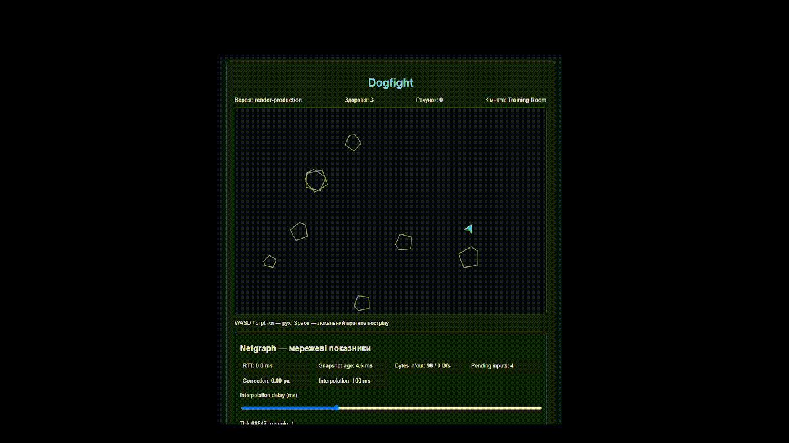
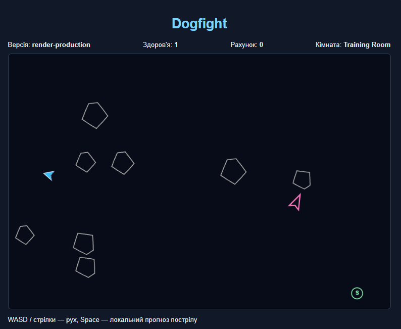
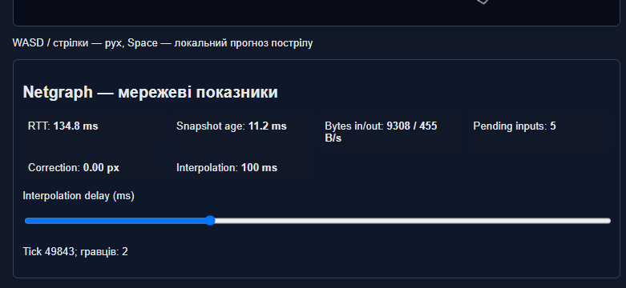
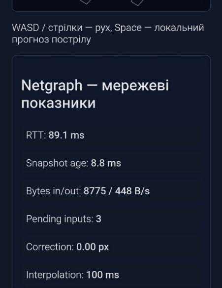
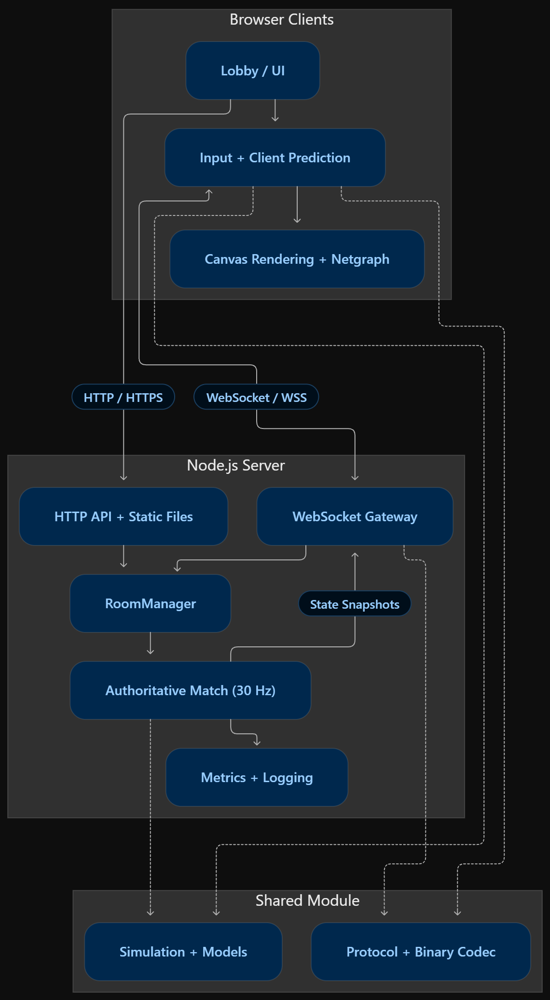
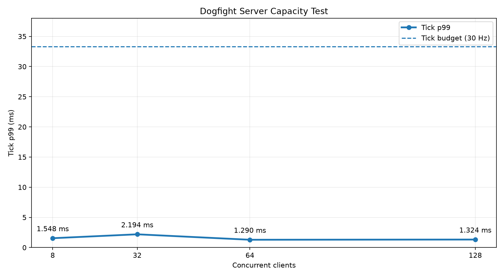
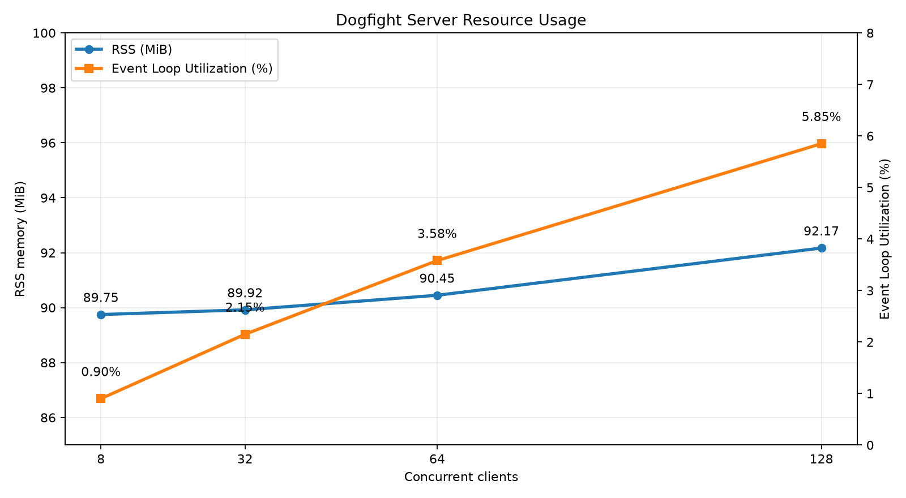

# Dogfight

**Dogfight** — багатокористувацька браузерна 2D-гра з космічними кораблями, астероїдами та стрільбою. Гравці підключаються до спільних кімнат і взаємодіють у реальному часі через WebSocket.

Проєкт реалізовано на TypeScript із використанням авторитетної серверної симуляції, клієнтського прогнозування руху, інтерполяції станів та компактного бінарного протоколу передавання даних.

**Версія:** 1.0.0

**[Грати онлайн](https://dogfight-5cit.onrender.com)** | **[Переглянути відеодемонстрацію](https://youtu.be/8cBfI63ORFY)**

> Публічна версія розгорнута на Render Free. Після періоду неактивності сервер може переходити в режим сну, тому перше завантаження іноді потребує додаткового часу.

## Демонстрація



У відеодемонстрації показано підключення гравців, ігровий процес, синхронізацію через WebSocket, мережеву статистику та серверний моніторинг.

**[Дивитися демонстраційне відео на YouTube](https://youtu.be/8cBfI63ORFY)**

### Скриншоти

**Ігровий процес**



**Мережеві показники**



**Підключення через мобільну мережу 4G+**



## Основні можливості

- Багатокористувацькі матчі в реальному часі через WebSocket.
- Лобі та окремі ігрові кімнати.
- Авторитетна серверна симуляція з частотою 30 Hz.
- Рух космічних кораблів, стрільба, астероїди та ігрові бонуси.
- Клієнтське прогнозування руху (client-side prediction).
- Узгодження клієнтського стану із серверним (reconciliation).
- Інтерполяція отриманих станів для плавного відображення.
- Компактний бінарний формат мережевих повідомлень.
- Вбудована панель Netgraph для аналізу мережевих показників.
- Серверні health checks, метрики та журналювання.
- Автоматизовані модульні, інтеграційні та E2E-тести.
- Контейнеризація через Docker.

## Технології

| Компонент | Технології |
|---|---|
| Мова програмування | TypeScript |
| Клієнт | Browser, Canvas, Vite |
| Сервер | Node.js, WebSocket (`ws`) |
| Спільна логіка | npm workspace `shared` |
| Тестування | Vitest, Playwright, Node.js Test Runner |
| Покриття коду | Vitest Coverage |
| Перевірка якості | ESLint, TypeScript |
| Логування | Pino |
| Контейнеризація | Docker, Docker Compose |
| Хостинг | Render |

## Архітектура



Проєкт організовано як npm-monorepo з трьома основними пакетами:

```text
dogfight/
├── client/              # Браузерний клієнт
│   ├── src/
│   └── bench/
├── server/              # Авторитетний ігровий сервер
│   ├── src/
│   ├── test/
│   └── bench/
├── shared/              # Спільні моделі, протокол і симуляція
│   ├── src/
│   ├── test/
│   └── bench/
├── e2e/                 # End-to-end тести
├── docs/
│   ├── architecture.png
│   └── screenshots/
├── Dockerfile
├── compose.yaml
└── package.json
```

### Принцип роботи

1. Користувач відкриває браузерний клієнт і підключається до кімнати.
2. Клієнт передає ігрові команди серверу через WebSocket.
3. Сервер виконує авторитетну симуляцію ігрового світу з частотою 30 Hz.
4. Сервер надсилає клієнтам знімки стану (snapshots).
5. Клієнт використовує прогнозування, узгодження та інтерполяцію для плавного відображення гри.

Модуль `shared` забезпечує узгодженість структур даних, моделей симуляції та мережевого протоколу між клієнтом і сервером.

## Локальний запуск

### Вимоги

- Node.js 22.6 або новіший.
- npm.
- Сучасний браузер із підтримкою WebSocket і Canvas.

### Встановлення

```bash
git clone https://github.com/f4nz3y/dogfight.git
cd dogfight
npm ci
```

### Запуск у режимі розробки

У першому терміналі:

```bash
npm run dev:server
```

У другому терміналі:

```bash
npm run dev:client
```

Відкрийте браузер за адресою:

```text
http://localhost:5173
```

Сервер за замовчуванням використовує порт `3001`.

### Збирання та запуск

```bash
npm run build
npm start
```

Після збирання сервер може обслуговувати статичні файли клієнта на порту `3001`.

### Запуск через Docker Compose

```bash
docker compose up -d --build
```

Гра буде доступна за адресою:

```text
http://localhost:3001
```

Перевірка стану сервера:

```text
http://localhost:3001/health
```

Зупинка контейнера:

```bash
docker compose down
```

## Конфігурація сервера

Основні змінні середовища:

| Змінна | Значення за замовчуванням | Призначення |
|---|---|---|
| `HOST` | `0.0.0.0` | Адреса прослуховування |
| `PORT` | `3001` | HTTP/WebSocket-порт |
| `LOG_DIR` | `logs` | Каталог журналів |
| `MAX_PAYLOAD` | `1024` | Максимальний розмір вхідного повідомлення, байти |
| `MAX_ROOMS` | `20` | Максимальна кількість кімнат |
| `MAX_PLAYERS_PER_ROOM` | `16` | Ліміт гравців у кімнаті |
| `MAX_CONNECTIONS_PER_IP` | `32` | Ліміт з'єднань з однієї IP-адреси |
| `ALLOWED_ORIGINS` | Локальні адреси клієнта й сервера | Дозволені джерела підключень |
| `LOG_LEVEL` | `info` | Рівень журналювання |
| `VERSION` | `dev` | Ідентифікатор версії |

У Docker Compose для локального запуску налаштовано порт `3001`, дозволені локальні джерела та значення версії `local-compose`.

## Моніторинг

Сервер надає HTTP-ендпоїнти для перевірки працездатності й аналізу стану:

| Ендпоїнт | Призначення |
|---|---|
| `/health` | Перевірка працездатності сервера |
| `/metrics` | Серверні метрики |
| `/api/stats` | Статистика ігрового сервера |

У браузерному клієнті також реалізовано Netgraph, який показує RTT, вік останнього знімка стану, вхідний і вихідний трафік, кількість непідтверджених команд, величину корекції позиції та інтерполяцію.

## Тестування

### Команди

```bash
npm test
npm run test:coverage
npm run test:e2e
npm run test:offline
npm run test:shared
npm run typecheck
npm run lint
```

Для вимірювання продуктивності доступні окремі команди:

```bash
npm run bench:codec
npm run bench:worker
npm run load
```

### Результати автоматизованого тестування

| Показник | Результат |
|---|---:|
| Unit/інтеграційні тести Vitest | 93/93 пройдено |
| E2E-тести Playwright | 1/1 пройдено |
| Покриття statements | 98,29% |
| Покриття branches | 96,62% |
| Покриття functions | 100% |
| Покриття lines | 97,89% |

Покриття наведено за результатами запуску `npm run test:coverage`.

## Продуктивність мережевого протоколу

Для порівняння JSON та бінарного протоколу використано тестовий стан із 4 гравцями, 8 астероїдами та 12 снарядами. Частота передавання — 30 Hz, кількість ітерацій бенчмарку — 100 000.

| Показник | JSON | Binary DataView |
|---|---:|---:|
| Розмір snapshot | 1965 байтів | 642 байти |
| Завантаження даних | 57,568 КіБ/с | 18,809 КіБ/с |
| Час encode/decode | 9,074 мкс | 0,704 мкс |
| Вихідний трафік клієнта | 1,758 КіБ/с | 0,381 КіБ/с |

**Результат:** бінарний snapshot приблизно на **67,3% менший**, а операція encode/decode приблизно у **12,9 раза швидша**, ніж для JSON, у виміряному сценарії.

## Навантажувальне тестування

Сервер протестовано зі сценаріями на 8, 32, 64 та 128 одночасних WebSocket-клієнтів. Тривалість кожного сценарію становила 5 секунд.

| Клієнтів | Tick p99, мс | RSS, МіБ | ELU, % | Трафік, МБ/с |
|---:|---:|---:|---:|---:|
| 8 | 1,548 | 89,75 | 0,90 | 0,110 |
| 32 | 2,194 | 89,92 | 2,15 | 0,694 |
| 64 | 1,290 | 90,45 | 3,58 | 1,385 |
| 128 | 1,324 | 92,17 | 5,85 | 2,747 |

У всіх чотирьох сценаріях кількість відхилених підключень становила **0**.

Для цього тестування використовувався окремий Docker-контейнер із `MAX_CONNECTIONS_PER_IP=256`, оскільки стандартний ліміт становить 32 підключення з однієї IP-адреси.

**Графік затримки серверного тіку**



**Графік використання ресурсів**



За частоти 30 Hz бюджет одного серверного тіку становить приблизно 33,33 мс. У виміряних сценаріях значення p99 залишалося значно нижчим за цей бюджет.

**Обмеження тесту:** 128 клієнтів — найбільша перевірена кількість, а не встановлена максимальна місткість сервера. Тестування проводилося переважно з пасивними клієнтами, тому результати не гарантують аналогічної продуктивності за максимально активного ігрового навантаження.

## Перевірка мережевого з'єднання

Проведено перевірку підключення двох гравців до публічного сервера Render із різних мереж.

| Показник | ПК | Смартфон (4G+) |
|---|---:|---:|
| RTT | 49,7 мс | 89,1 мс |
| Snapshot age | 26,2 мс | 8,8 мс |
| Вхідний трафік | 7688 Б/с | 8775 Б/с |
| Вихідний трафік | 453 Б/с | 448 Б/с |
| Pending inputs | 2 | 3 |
| Correction | 0 px | 0 px |
| Interpolation | 100 мс | 100 мс |

Наведені значення є моментальними показниками Netgraph під час тестування, а не середніми значеннями за тривалий період.

## Розгортання

Публічну версію гри розгорнуто на платформі Render.

**Адреса:** https://dogfight-5cit.onrender.com

Docker-образ створюється за допомогою багатостадійного `Dockerfile`. На етапі збирання встановлюються залежності та збирається клієнт, після чого в кінцевий образ копіюються необхідні файли для запуску.

Контейнер працює від непривілейованого користувача, відкриває порт `3001` і містить перевірку працездатності через `/health`.

## Автор

**Антон Орлов**

Студент спеціальності «Інженерія програмного забезпечення».

GitHub: https://github.com/f4nz3y
