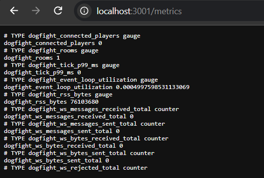
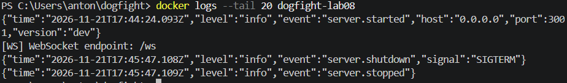
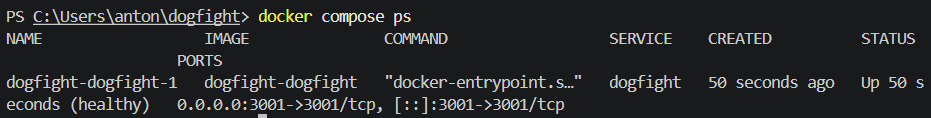
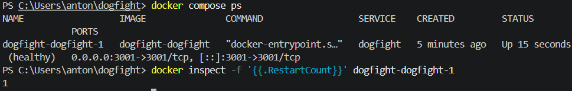
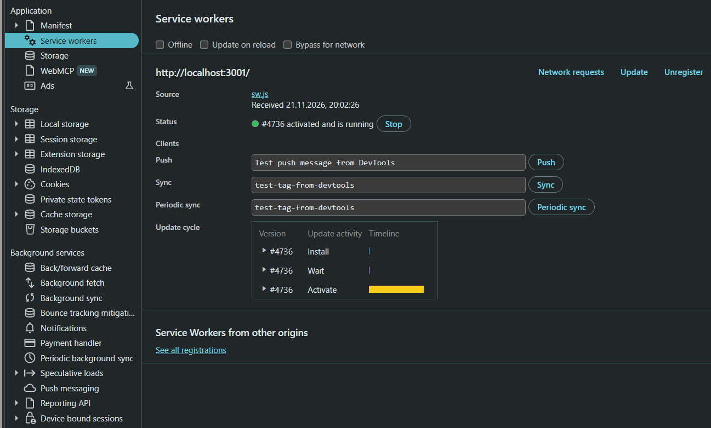
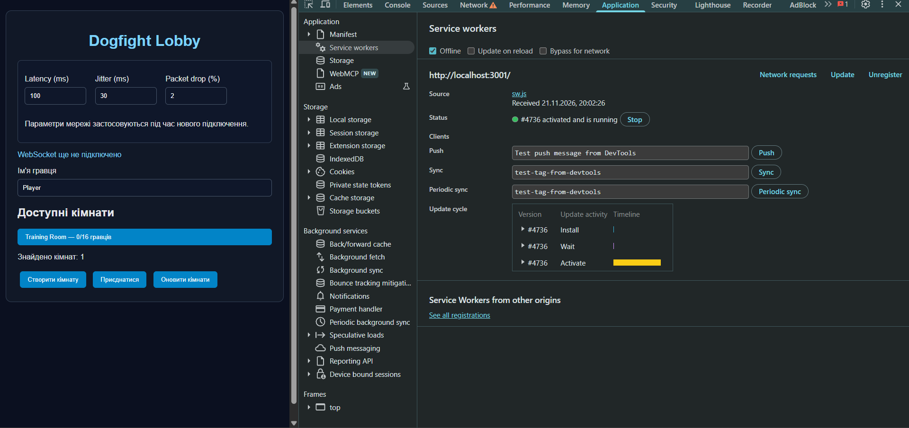
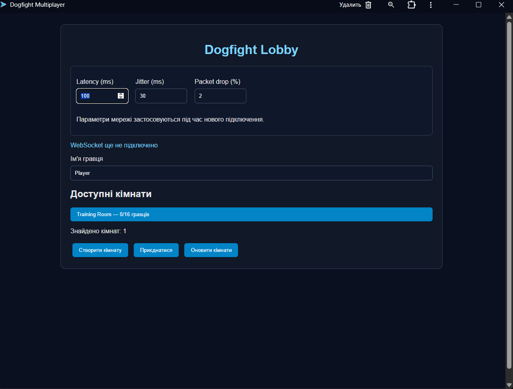

# Лабораторна робота №8 — Ship It

**Проєкт:** Dogfight — багатокористувацька браузерна гра  
**Технології:** TypeScript, Node.js, WebSocket, Vite, Docker, Docker Compose, GitHub Actions, PWA

## 1. Мета роботи

Метою лабораторної роботи є підготовка багатокористувацького вебзастосунку до розгортання, контейнеризація клієнтської та серверної частин, налаштування моніторингу стану сервера, структурованого журналювання, автоматичного відновлення після збоїв і підтримки Progressive Web App.

## 2. Моніторинг стану сервера

Для перевірки працездатності застосунку реалізовано HTTP-ендпоінти:

- `/health` — перевірка роботи серверного процесу;
- `/ready` — перевірка готовності сервера;
- `/metrics` — отримання метрик у форматі Prometheus.

Ендпоінт `/metrics` надає інформацію про кількість підключених гравців, активних кімнат, повідомлень WebSocket, переданих байтів, відхилених підключень, використання пам'яті та завантаженість циклу подій.

Під час перевірки встановлено, що ендпоінти `/health` і `/ready` повертають HTTP 200, а `/metrics` формує текстову відповідь із поточними значеннями показників.

**Результат:** реалізовано базові засоби спостереження за станом сервера.



## 3. Структуроване журналювання та завершення роботи

Для серверної частини реалізовано структуроване журналювання у форматі JSON. Записи містять час події, рівень важливості, назву події та додаткові параметри.

Перевірено коректне завершення роботи сервера після отримання сигналу `SIGTERM`. У журналі зафіксовано події `server.shutdown` та `server.stopped`.

**Результат:** сервер підтримує структуровані журнали та контрольоване завершення роботи.



## 4. Контейнеризація застосунку

Для контейнеризації створено багатостадійний `Dockerfile` на основі `node:22-alpine`. На етапі збірки встановлюються залежності та компілюється клієнтська частина. У фінальний образ переносяться необхідні файли застосунку.

Для локального запуску створено `compose.yaml`, у якому налаштовано сервер, змінні середовища, мережевий порт і політику перезапуску.

Контейнер успішно зібрано та запущено командою:

```bash
docker compose up -d --build
```

Після запуску ендпоінти `/health` і `/ready` повернули успішні відповіді з версією `local-compose`.

**Результат:** застосунок запускається в Docker Compose.



## 5. Перевірка відновлення після збою

Для перевірки стійкості застосунку змодельовано аварійне завершення основного процесу Node.js сигналом `SIGKILL`.

Після завершення процесу Docker автоматично перезапустив контейнер відповідно до налаштованої політики `restart: unless-stopped`.

Перевірка показала `RestartCount = 1`, а контейнер після перезапуску повернувся до стану `healthy`.

**Результат:** підтверджено автоматичне відновлення серверного контейнера після аварійного завершення процесу.



## 6. Реалізація Progressive Web App

Для підтримки PWA створено файл `app.webmanifest` із назвою застосунку, параметрами запуску, кольорами оформлення та іконками розміром 192×192 і 512×512 пікселів.

Також реалізовано Service Worker, який кешує основні ресурси інтерфейсу та дозволяє повторно відкривати його без доступу до мережі.

У Chrome DevTools підтверджено, що Service Worker зареєстрований і перебуває в активному стані.



### 6.1. Перевірка автономного режиму

Для перевірки автономної роботи у Chrome DevTools увімкнено режим Offline та виконано повторне завантаження сторінки.

Інтерфейс Dogfight Lobby успішно відобразився завдяки кешованим ресурсам. Водночас підключення WebSocket було недоступним, оскільки багатокористувацька гра потребує з'єднання із сервером.

**Результат:** підтверджено автономне завантаження інтерфейсу, але не автономну роботу багатокористувацького режиму.



### 6.2. Встановлення застосунку

Після оновлення PWA-маніфесту та додавання PNG-іконок Chrome дозволив встановити Dogfight Multiplayer як окремий застосунок.

Встановлений PWA успішно відкрився у власному вікні без стандартної адресної панелі браузера.

**Результат:** підтверджено можливість встановлення Dogfight як PWA.



## 7. Автоматизація публікації

Для автоматизації публікації Docker-образу підготовлено GitHub Actions workflow `.github/workflows/release.yml`.

Workflow передбачає запуск за Git-тегами формату `v*`, збірку Docker-образу та його публікацію до GitHub Container Registry.

Також передбачено необов'язковий виклик deployment webhook за наявності відповідного секрету.

**Поточний стан:** конфігурацію підготовлено локально; успішна публікація образу до GHCR ще потребує перевірки.

## 8. Перевірка якості коду

Під час виконання роботи проведено такі перевірки:

| Перевірка | Результат |
|---|---|
| TypeScript typecheck | Успішно |
| ESLint | Успішно |
| Offline-тести Vitest | 86 тестів пройдено |
| Production build | Успішно |
| Docker build | Успішно |
| Docker Compose | Успішно |
| Health та readiness | HTTP 200 |
| Автоматичний перезапуск | Підтверджено |
| Service Worker | Активний |
| PWA offline UI | Працює |
| Встановлення PWA | Успішно |
| Публікація GHCR | Очікує перевірки |

## 9. Висновок

Під час виконання лабораторної роботи №8 було підготовлено гру Dogfight до контейнеризованого запуску. Реалізовано перевірки працездатності сервера, збір метрик, структуроване журналювання та контрольоване завершення процесу. За допомогою Docker і Docker Compose забезпечено запуск застосунку в ізольованому середовищі, а також перевірено його автоматичне відновлення після аварійного завершення.

Окрему увагу приділено реалізації Progressive Web App. Було налаштовано маніфест, Service Worker, кешування ресурсів і встановлення застосунку через Chrome. Перевірки підтвердили можливість автономного завантаження інтерфейсу та встановлення Dogfight як окремої програми. Для подальшої автоматизації підготовлено workflow публікації Docker-образу в GitHub Container Registry, перевірку якого необхідно завершити перед остаточним оформленням релізу.
