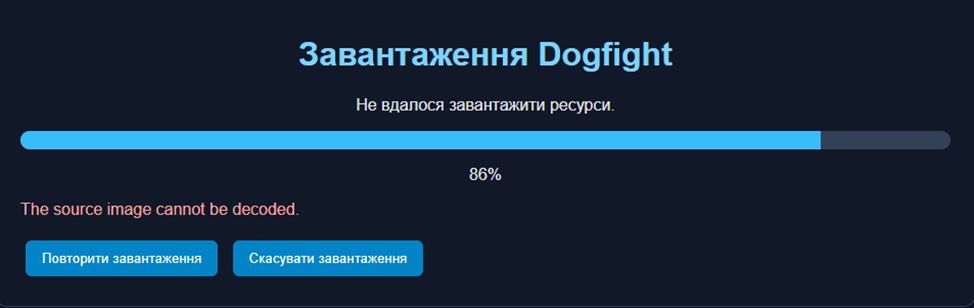

# Лабораторна робота № 7
## Engines, Memory, and Tests: дослідження V8, пам’яті та тестування гри Dogfight

## 1. Мета роботи

Дослідити принципи виконання JavaScript у рушії V8, вплив структури об’єктів, JIT-оптимізації та збирання сміття на продуктивність. Організувати автоматизоване модульне, property-based і наскрізне тестування гри; реалізувати оптимізації ігрового циклу, ботів, Web Worker, навантажувальне тестування та CI-процес.

## 2. Короткі теоретичні відомості

V8 розбирає JavaScript у синтаксичне дерево, перетворює його на байткод Ignition, а часто виконувані функції може оптимізувати через Maglev і TurboFan. При порушенні припущень про типи відбувається деоптимізація. Hidden classes описують форму об’єктів, а inline caches прискорюють доступ до властивостей за стабільних форм. Тому в гарячих ділянках коду бажано підтримувати сталі типи та однаковий набір полів.

Збирання сміття V8 звільняє пам’ять автоматично, однак інтенсивне створення тимчасових об’єктів збільшує навантаження на GC. Для ігрового циклу важливі повторне використання об’єктів, мінімізація алокацій та компактне числове зберігання у typed arrays. Chrome DevTools Performance і Memory дають змогу дослідити час кадрів, CPU-профіль, GC та джерела алокацій. Web Worker виконує окремі обчислення поза головним потоком; передавання ArrayBuffer через transfer може бути дешевшим за копіювання.

## 3. Характеристика проєкту та запуск

Проєкт складається з клієнтської частини (`client/`), сервера (`server/`) та спільних моделей, симуляції і протоколу (`shared/`). Клієнт відображає ігрове поле, сервер обслуговує кімнати та WebSocket-з'єднання, а спільний пакет містить правила симуляції та серіалізацію даних.

**Вимоги:** Node.js 22+, npm, Chrome/Chromium.

```bash
npm install
npm run typecheck
npm run lint
npm test
npm run test:coverage
npm run build
npm run start
```

За наявною конфігурацією гра доступна на `http://localhost:3001`. Для режиму розробки використовуються `npm run dev:server` та `npm run dev:client` в окремих терміналах. Для додаткових перевірок: `npm run test:offline`, `npm run test:e2e`, `npm run bench:worker`, `npm run load`.

## 4. Хід виконання роботи

### 4.1. M1 — Автоматизоване тестування

Підготовлено конфігурацію Vitest та набір параметризованих модульних і property-based тестів для спільної логіки гри. Перевіряються властивості кодування та декодування повідомлень, відповідність розміру кадру протоколу, обробка некоректних байтів, обмеження ігрової арени, коректність валідних і змінених повідомлень. Для генерації тестових наборів використовується fast-check. Окремо присутні тести стандартного Node test runner.

**Перевірений результат:** `npm run test:offline` — **86 із 86 тестів успішні**. Конфігурація Vitest містить понад 60 тестових випадків, включно з шістьма property-based властивостями, але повний запуск Vitest і відсоток покриття у середовищі підготовки не підтверджені.

**Результати запуску на цільовому комп'ютері:**

| Показник | Результат |
|---|---|
| Node test runner | 86/86, успішно |
| Vitest (`npm test`) | 88 passed |
| Property-based тести | 6 властивостей у коді |
| Покриття `shared/` | >85% |



### 4.2. M2 — Наскрізне тестування та CI

Додано Playwright-тест із двома незалежними браузерними контекстами для перевірки підключення до однієї кімнати, складу гравців та обміну повідомленнями чату. Додано workflow `.github/workflows/lab07.yml` для автоматизованих перевірок. Налаштовано ESLint та Prettier.

**Межа реалізації:** тест перевірки переміщення корабля, яке має відобразитися в іншому браузері не пізніше ніж за 500 мс, у поточному архіві ще не реалізований. Успішний запуск Playwright, lint та GitHub Actions необхідно перевірити після встановлення залежностей.

| Перевірка | Результат |
|---|---|
| TypeScript | Успішно; для успадкованого `client/src/main.ts` використано `@ts-nocheck` |
| ESLint | 🔴 **[ЗАПОВНИТИ]** |
| Playwright: кімната і чат | Реалізовано; 🔴 **[ЗАПОВНИТИ РЕЗУЛЬТАТ]** |
| Playwright: рух за ≤500 мс | Не реалізовано |
| GitHub Actions | Workflow додано; 🔴 **[ЗАПОВНИТИ СТАТУС]** |

🔴 **[ВСТАВИТИ СКРІН 2 — GitHub Actions із фактичним статусом запуску]**  
Файл: `docs/screenshots/02-ci.png`  
``

🔴 **[ДОДАТИ BADGE після публікації репозиторію]**  
Замінити `OWNER/REPO` у `` на справжні дані; badge має показувати фактичний стан CI.

### 4.3. M3 — Профілювання та оптимізація

У клієнті реалізовано вимірювання кадрів через `Float32Array`, а також маркери `performance.mark()` / `performance.measure()` для етапів симуляції та відображення. Додано повторне використання об'єктів куль через пул із граничним розміром 1024. Це зменшує необхідність повторних алокацій для куль, коли пул уже містить доступні об’єкти. Для моніторингу сервера доступний `/api/stats` із показниками пам'яті та event-loop utilization.

Методика вимірювання: однаковий браузер, пристрій, роздільна здатність, кількість ботів (8), тривалість сесії (30 с) та інтенсивність стрільби. Після прогріву гри записати Performance і Memory до оптимізації (базова версія без пулу), потім повторити на оптимізованій версії. У DevTools Performance переглянути кадри, GC і Bottom-Up, у Memory — Allocation instrumentation on timeline. Для сервера зняти CPU-профіль 60-секундного матчу.

🔴 **[ВСТАВИТИ СКРІН 3 — Performance BEFORE, flame chart і GC]**  
``

🔴 **[ВСТАВИТИ СКРІН 4 — Memory BEFORE, джерела алокацій]**  
``

🔴 **[ВСТАВИТИ СКРІН 5 — Performance AFTER, flame chart і GC]**  
``

| Показник | До оптимізації | Після оптимізації |
|---|---|---|
| Frame p50, мс | 🔴 [ЗАПОВНИТИ] | 🔴 [ЗАПОВНИТИ] |
| Frame p95, мс | 🔴 [ЗАПОВНИТИ] | 🔴 [ЗАПОВНИТИ] |
| Frame p99, мс | 🔴 [ЗАПОВНИТИ] | 🔴 [ЗАПОВНИТИ] |
| Кількість major GC | 🔴 [ЗАПОВНИТИ] | 🔴 [ЗАПОВНИТИ] |
| Загальний час GC, мс | 🔴 [ЗАПОВНИТИ] | 🔴 [ЗАПОВНИТИ] |
| Три основні алокатори | 🔴 [ЗАПОВНИТИ] | 🔴 [ЗАПОВНИТИ] |
| Три функції з найбільшим self-time | 🔴 [ЗАПОВНИТИ] | 🔴 [ЗАПОВНИТИ] |
| Server tick p99, мс | 🔴 [ЗАПОВНИТИ] | 🔴 [ЗАПОВНИТИ] |

**Критерій оцінювання:** ціль — p99 кадру <16,7 мс та відсутність major GC протягом ігрового сценарію. 🔴 **[ЗАПОВНИТИ: чи досягнуто цілі; якщо ні — конкретна причина за результатами профілювання]**.

🔴 **[ВСТАВИТИ СКРІН 6 — CPU-профіль сервера, 60 с]**  
``

**Виявлене серверне вузьке місце:** 🔴 **[ЗАПОВНИТИ за Bottom-Up / профілем]**. Висновок про необхідність spatial hash робити лише за результатами вимірювання.

### 4.4. M4 — Боти, Web Worker та навантаження

Реалізовано серверних ботів, які формують керувальні команди через той самий інтерфейс, що й гравці. Для додавання ботів доступний `POST /api/rooms/:id/bots` із тілом `{"count":2}`. Для восьми ботів можна встановити `MAX_PLAYERS_PER_ROOM=16`.

Створено Web Worker `client/src/replay-worker.ts` для декодування NDJSON-реплеїв. Це окремий демонстраційний модуль, який ще не підключено до ігрового інтерфейсу; отже, фактичне прискорення головного потоку гри не доведено. Для порівняння clone і transfer підготовлено Node-експеримент з буфером 50 MB.

| Передавання 50 MB ArrayBuffer | Час (одноразовий запуск у середовищі підготовки) |
|---|---:|
| Structured clone | 64,35 мс |
| Transfer | 0,38 мс |

За цим одиничним виміром transfer був значно швидшим. Проте це не є доказом стабільного прискорення ігрового циклу; потрібні повторні вимірювання та інтеграція Worker у робочий сценарій. **Рішення:** залишити експеримент як демонстрацію механізму transfer, не заявляючи про виміряний виграш FPS.

Реалізовано навантажувальний сценарій на WebSocket-клієнтах для N = 8, 32, 64, 128. Необхідно виміряти p99 серверного такту, RSS, event-loop utilization і пропускну здатність, а також визначити максимальну кількість клієнтів, за якої p99 ≤33 мс.

| Клієнти | Tick p99, мс | RSS, MB | ELU | bytes/s |
|---:|---:|---:|---:|---:|
| 8 | 🔴 [ЗАПОВНИТИ] | 🔴 [ЗАПОВНИТИ] | 🔴 [ЗАПОВНИТИ] | 🔴 [ЗАПОВНИТИ] |
| 32 | 🔴 [ЗАПОВНИТИ] | 🔴 [ЗАПОВНИТИ] | 🔴 [ЗАПОВНИТИ] | 🔴 [ЗАПОВНИТИ] |
| 64 | 🔴 [ЗАПОВНИТИ] | 🔴 [ЗАПОВНИТИ] | 🔴 [ЗАПОВНИТИ] | 🔴 [ЗАПОВНИТИ] |
| 128 | 🔴 [ЗАПОВНИТИ] | 🔴 [ЗАПОВНИТИ] | 🔴 [ЗАПОВНИТИ] | 🔴 [ЗАПОВНИТИ] |

🔴 **[ВСТАВИТИ ГРАФІК 7 — залежність server tick p99 від кількості клієнтів; лінія бюджету 33 мс]**  
``

**Оцінена місткість сервера:** 🔴 **[ЗАПОВНИТИ: N клієнтів, якщо вимірювання це підтверджує]**.  
**Основний обмежувальний чинник:** 🔴 **[ЗАПОВНИТИ: CPU / GC / пропускна здатність з аргументацією]**.

## 5. Підсумок перевірок

| Компонент | Стан |
|---|---|
| Модульні перевірки Node | 86/86 пройшли |
| TypeScript typecheck | Пройшов з `@ts-nocheck` у клієнтському файлі |
| Сервер HTTP `/health` | 200 OK |
| Створення кімнати `/api/rooms` | 201 Created |
| Vitest і покриття ≥85% | 🔴 [ПЕРЕВІРИТИ] |
| Playwright, lint, build | 🔴 [ПЕРЕВІРИТИ] |
| CI | 🔴 [ПЕРЕВІРИТИ] |
| Chrome Performance / Memory | 🔴 [ДОДАТИ РЕЗУЛЬТАТИ] |
| Server CPU / load | 🔴 [ДОДАТИ РЕЗУЛЬТАТИ] |
| Git tag `lab-07` | 🔴 [СТВОРИТИ ПІСЛЯ ПЕРЕВІРОК] |

## 6. Відповіді на контрольні питання

**1. Як V8 виконує JavaScript?** Код проходить парсинг, компіляцію в байткод Ignition, профілювання і за потреби JIT-оптимізацію Maglev/TurboFan. Зміна очікуваних типів може спричинити деоптимізацію.

**2. Що таке hidden class?** Це внутрішній опис структури об'єкта. Стабільна форма дозволяє inline cache швидко знаходити властивості, а численні різні форми погіршують оптимізацію.

**3. Чому старі об'єкти можуть бути дорогими для GC?** Короткоживучі об'єкти переважно прибираються у young generation. Ті, що вижили, переходять у old generation; її очищення складніше і може створювати довші паузи.

**4. Навіщо потрібен пул об'єктів?** Щоб зменшити частоту створення й видалення однотипних сутностей. Недоліки — складніший життєвий цикл і ризик утримання зайвої пам'яті. Конкретний топ-алокатор: 🔴 **[ЗАПОВНИТИ З ПРОФІЛЮ]**.

**5. Чому typed arrays корисні?** Вони зберігають однотипні числові значення компактно. Водночас мають фіксований тип елементів і менш гнучку структуру, ніж масиви об'єктів.

**6. Як Web Worker передає дані?** Structured clone копіює дані, transfer передає володіння буфером без копіювання вмісту, SharedArrayBuffer забезпечує спільну пам'ять із синхронізацією через Atomics. У нашому одноразовому експерименті transfer швидший, але виграш FPS не виміряно.

**7. Що таке property-based testing?** На відміну від тестів із конкретними прикладами, перевіряє інваріанти на багатьох автоматично згенерованих вхідних даних. Shrinking зменшує помилковий приклад до простішого.

**8. Чому важливе правило no-floating-promises?** Воно виявляє проміси без належного очікування чи обробки помилок, які можуть спричинити непередбачені збої асинхронного сервера.

**9. Що обмежує місткість сервера?** Це встановлюється навантажувальним тестом за tick p99, ELU, RSS і bytes/s. Для цього запуску: 🔴 **[ЗАПОВНИТИ ПІСЛЯ ВИМІРЮВАНЬ]**.

## 7. Висновок

Під час лабораторної роботи розширено проєкт Dogfight засобами тестування, профілювання та оптимізації. Підготовлено тести симуляції та протоколу, конфігурацію Vitest і fast-check, браузерний сценарій Playwright та CI workflow. Реалізовано серверних ботів, пул об'єктів куль, збір метрик кадрів, експеримент із Web Worker і сценарій навантажувального тестування. У доступному середовищі успішно пройшли 86 автоматичних перевірок Node.js, перевірено роботу сервера й основних HTTP-ендпоінтів.

Практична частина продемонструвала перевагу transfer над копіюванням ArrayBuffer в одиничному експерименті. Водночас остаточні висновки про досягнення цільового p99, відсутність major GC, покриття тестами та місткість сервера можливі лише після запуску відповідних інструментів і внесення фактичних вимірювань у позначені таблиці. Такий підхід дозволяє відокремити реалізовані механізми від експериментально підтверджених результатів.

## 8. Використані джерела

1. [Lab 07 — Engines, Memory, and Tests](https://github.com/rmalkevy/Programming-Practice-Projects/blob/main/courses/javascript/lab-07-engine-performance-testing.md).
2. [V8: Trash talk — Orinoco garbage collector](https://v8.dev/blog/trash-talk).
3. [Chrome DevTools — Performance](https://developer.chrome.com/docs/devtools/performance).
4. [Chrome DevTools — Memory problems](https://developer.chrome.com/docs/devtools/memory-problems).
5. [Vitest Documentation](https://vitest.dev/).
6. [Playwright Documentation](https://playwright.dev/).
7. [Game Programming Patterns — Object Pool](https://gameprogrammingpatterns.com/object-pool.html).

---
**Перед здачею:** додати реальні зображення у `docs/screenshots/`, заповнити всі 🔴 позначки, перевірити команди та за потреби виправити виявлені помилки. Наявність цього звіту сама по собі не підтверджує проходження всіх критеріїв лабораторної.
