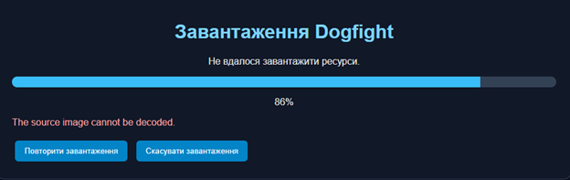
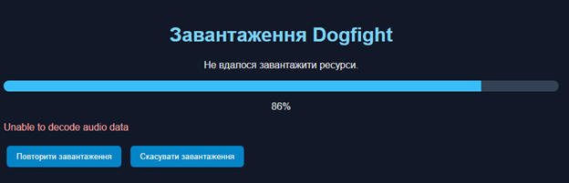
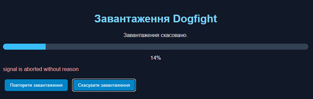
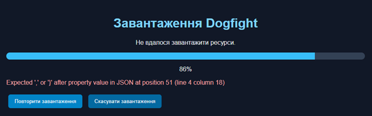

# Lab 03 — Asynchronous JavaScript

## 1. Реалізовані можливості

У третій лабораторній роботі було реалізовано асинхронне завантаження ресурсів та розширено гру Dogfight.

Основні можливості:

- Завантаження зображень, звуків і JSON.
- Отримання ресурсів через Fetch API.
- Перевірка HTTP-статусу через response.ok.
- Повторні спроби завантаження з експоненційною затримкою та jitter.
- Скасування запитів через AbortController.
- Паралельне завантаження ресурсів за допомогою Promise.all.
- Відображення прогресу завантаження.
- Обробка помилок і можливість повторного завантаження.
- Відображення корабля, астероїдів і куль через спрайти.
- Відтворення звуків через Web Audio API.
- Система подій EventTarget і CustomEvent.
- HTTP-лобі зі списком доступних кімнат.
- Періодичне оновлення списку кімнат і скасування запитів після виходу з лобі.

## 2. Асинхронне завантаження ресурсів

Для завантаження ресурсів створено модуль `loader.js`.

Він містить функції `fetchJson`, `loadImage`, `loadAudio`, `loadJson`, `withRetry` і `loadAll`.

Завантаження виконується паралельно за допомогою Promise.all. Після успішного отримання кожного ресурсу оновлюється індикатор прогресу.

Для тимчасових помилок використовується експоненційна затримка з випадковим відхиленням. Помилки HTTP 4xx не повторюються, оскільки вони зазвичай вказують на некоректний запит або відсутній ресурс.

## 3. Порівняння послідовного та паралельного завантаження

Для порівняння використано дві асинхронні операції тривалістю приблизно одну секунду кожна.

При послідовному виконанні друга операція починається лише після завершення першої. Загальний час становить приблизно дві секунди.

При паралельному виконанні через Promise.all обидві операції запускаються одночасно. Загальний час становить приблизно одну секунду.

Отже, паралельне виконання дає змогу скоротити час очікування, коли операції не залежать одна від одної.

## 4. Система подій і Web Audio

Для взаємодії між ігровою симуляцією та аудіомодулем використано EventTarget і CustomEvent.

Симуляція генерує події `fired`, `hit` та `exploded`. Модуль `audio.js` підписується на ці події та відтворює відповідні звуки.

Такий підхід відокремлює ігрову логіку від аудіореалізації. Симуляція не імпортує аудіомодуль і не залежить від його внутрішньої реалізації.

Звуки завантажуються та декодуються під час початкового завантаження гри. AudioContext активується після дії користувача.

## 5. Lobby over HTTP

Реалізовано клас Lobby, який успадковує EventTarget.

Метод refresh() отримує список кімнат із `/api/rooms`. Метод startRefreshing() забезпечує періодичне оновлення списку.

Для обмеження часу очікування використовується AbortSignal.timeout(5000), а для скасування активного запиту — AbortController.

Після виходу з лобі періодичне оновлення зупиняється, а активний запит скасовується.

Відображення кімнат реалізовано окремо в `lobbyView.js`, тому логіка роботи з даними не залежить від DOM.

## 6. П'ять завдань на порядок виконання асинхронного коду

### Завдання 1

```javascript
console.log("A");
Promise.resolve().then(() => console.log("B"));
console.log("C");
```

Результат: A, C, B.

Пояснення: синхронний код виконується раніше за обробник Promise, який потрапляє до черги мікрозадач.

### Завдання 2

```javascript
async function test() {
  console.log("A");
  await Promise.resolve();
  console.log("B");
}

test();
console.log("C");
```

Результат: A, C, B.

Пояснення: await призупиняє функцію, а її продовження виконується як мікрозадача.

### Завдання 3

```javascript
Promise.resolve().then(() => {
  console.log("A");
  setTimeout(() => console.log("B"), 0);
}).then(() => console.log("C"));

console.log("D");
```

Результат: D, A, C, B.

Пояснення: синхронний код виконується першим, потім мікрозадачі, а callback таймера — пізніше.

### Завдання 4

```javascript
console.log("A");

requestAnimationFrame(() => console.log("B"));

Promise.resolve().then(() => console.log("C"));

console.log("D");
```

Результат: A, D, C, B.

Пояснення: спочатку виконується синхронний код, потім мікрозадача Promise, а callback requestAnimationFrame — перед наступним відображенням кадру.

### Завдання 5

```javascript
console.log("A");

setTimeout(() => console.log("B"), 0);

Promise.resolve().then(() => console.log("C"));

(async () => {
  console.log("D");
  await 0;
  console.log("E");
})();

console.log("F");
```

Результат: A, D, F, C, E, B.

Пояснення: синхронні операції виконуються першими, потім мікрозадачі, а після них — задача таймера.

## 7. Failure gallery

Під час перевірки було розглянуто чотири сценарії помилок:

1. **404 — відсутній ресурс.** Тимчасове перейменування `asteroid.svg` спричиняє помилку HTTP 404. Завантаження переривається, користувач отримує повідомлення та може повторити спробу після відновлення файлу.



2. **Network timeout.** Перевірено тайм-аут HTTP-запиту через AbortSignal.timeout. Після завершення часу очікування запит скасовується.



3. **Abort during loading.** Під час завантаження натиснуто кнопку скасування. AbortController перериває активні запити, а користувач отримує повідомлення про скасування.



4. **Corrupt JSON.** Некоректний вміст `arena.json` спричиняє помилку під час читання JSON. Програма показує повідомлення й дозволяє повторити завантаження після виправлення файлу.

